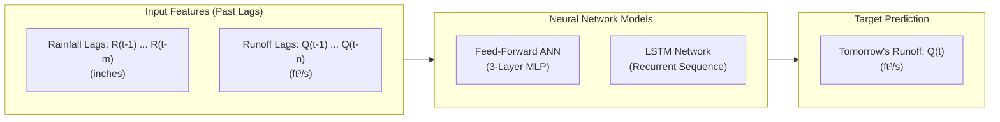

# Streamflow Forecasting with Artificial Neural Networks

Daily one-step-ahead streamflow (runoff) prediction for the Leaf River basin (Collins, MS/LA) comparing a **3-Layer Feed-Forward Neural Network (ANN)** and a **Long Short-Term Memory (LSTM) Recurrent Neural Network**.

*Course Mini-Project for **UE24CS352A - Machine Learning**, based on research by Mian Xiao & Shanni You (Stanford University, 2018), Hsu et al. (1995), and Kratzert et al. (2018).*

---

## 1. Project Introduction

### What Does This Project Do?
In hydrology and civil engineering, **streamflow forecasting** predicts the volume of water moving through a river channel over time. Accurate daily forecasts are essential for:
* **Flood warning systems**: Giving downstream communities advance notice before rivers breach their banks.
* **Reservoir and dam management**: Scheduling releases and preserving storage capacity.
* **Water resource allocation**: Ensuring municipal, agricultural, and industrial water security.

This project implements machine learning models that learn the nonlinear relationship between rainfall events and river discharge, forecasting tomorrow's river flow based on recent historical rainfall and runoff.

### Problem Formulation
* **Type of ML Problem**: **Supervised Multivariate Time-Series Regression**.
  * *Supervised*: Trained against historical ground-truth sensor measurements.
  * *Multivariate*: Combines two distinct historical time-series signals (rainfall and river flow).
  * *Time-Series Regression*: The target is a continuous physical quantity measured sequentially in time.

### Inputs and Outputs



* **Inputs (Features)**:
  * **Rainfall Lags $R(t-1), \dots, R(t-m)$**: Historical daily precipitation in inches (from NOAA weather station at Collins).
  * **Runoff Lags $Q(t-1), \dots, Q(t-n)$**: Historical daily mean discharge in $\text{ft}^3/\text{s}$ (from USGS river gauge 02472000).
  * *Default lookback*: 3 days rain / 4 days runoff for Feed-Forward; 5 days paired sequence for LSTM.
* **Output (Target)**:
  * **Next-Day Streamflow $Q(t)$**: Predicted river discharge for day $t$ in cubic feet per second ($\text{ft}^3/\text{s}$).

---

## 2. Repository & Folder Structure

```
streamflow-ann/
├── data/
│   ├── leaf_river.csv            # Cleaned & merged 10-year dataset (2003–2012)
│   ├── raw_noaa_rain.csv         # Raw NOAA precipitation measurements
│   └── raw_usgs_discharge.csv    # Raw USGS daily mean river flow
├── docs/
│   ├── Guidelines and Instructions_Mini Project Assignment.pdf
│   ├── Xiao_You.pdf              # Stanford research paper (reference study)
│   └── Xiao_You (1).pdf          # Stanford research presentation poster
├── new_data/                     # Unprocessed original agency downloads
│   ├── 4412641.csv               # Raw NOAA download
│   └── daily-data-mean.csv       # Raw USGS download
├── results/                      # Generated model weights, metrics, and plots
│   ├── metrics.json              # Full evaluation results (RMSE, NSE, KGE)
│   ├── model_feedforward.pt      # Saved PyTorch Feed-Forward weights
│   ├── model_lstm.pt             # Saved PyTorch LSTM weights
│   ├── pred_comparison.png       # Side-by-side comparison hydrograph
│   ├── peak_event_zoom.png       # 60-day zoom-in hydrograph of major flood peak
│   ├── pred_feedforward.png      # Feed-Forward validation & scatter plots
│   └── pred_lstm.png             # LSTM validation & scatter plots
├── src/
│   ├── __init__.py
│   ├── data.py                   # Data cleaning, lag windowing, normalization
│   ├── metrics.py                # RMSE, peak error, NSE, and KGE calculations
│   ├── models.py                 # PyTorch architectures (FeedForward, LSTMNet)
│   ├── predict.py                # CLI model testing tool for custom scenarios or dates
│   ├── prepare_data.py           # Data pipeline: merges NOAA rain & USGS flow into CSV
│   ├── sweep.py                  # Hyperparameter grid search & heatmap generator
│   └── train.py                  # Training loop with peak-weighted MSE loss
├── tests/
│   ├── test_data.py              # Tests for window alignment & data leakage
│   └── test_metrics.py           # Unit tests for RMSE, NSE, and KGE
├── app.py                        # Interactive Streamlit Web Dashboard (live demo)
├── main.py                       # Main experiment runner (trains, evaluates, plots, saves)
├── requirements.txt              # Project Python dependencies
└── README.md                     # Project documentation
```

### File Descriptions

| File / Directory | Description |
| :--- | :--- |
| **`app.py`** | **Interactive Streamlit Web Dashboard**. Features What-If flood simulation, 2008–2012 historical date testing, live flood warning badges, and hydrograph views. Ideal for viva/live demos. |
| **`main.py`** | Primary execution script. Trains Feed-Forward and LSTM models, benchmarks against persistence, outputs metrics, generates plots, and saves model checkpoints (`.pt`). |
| **`src/predict.py`** | **CLI Model Testing Tool**. Allows immediate inference with custom rain/runoff values or historical date lookups from the terminal. |
| **`src/sweep.py`** | Hyperparameter tuning script. Sweeps across lag windows ($2\text{ to }7$ days) and hidden layer sizes ($8\text{ to }20$), generating parameter-space heatmaps. |
| **`src/prepare_data.py`** | Preprocessing pipeline. Filters the primary NOAA station at Collins, distributes multi-day precipitation totals, aligns USGS discharge, and writes `data/leaf_river.csv`. |
| **`src/data.py`** | Handles missing-value interpolation (up to 3 days on discharge), lag window sliding, chronologic 2003–2007 train and 2008–2012 validation split, and $[0, 1]$ feature scaling. |
| **`src/models.py`** | PyTorch neural network modules: 3-layer `FeedForward` (Linear $\to$ Sigmoid $\to$ Linear) and recurrent `LSTMNet` with sequence tensor reshaping. |
| **`src/train.py`** | Training engine with Adam optimizer, batching, best-validation-epoch tracking, and customizable **Peak-Weighted Loss**. |
| **`src/metrics.py`** | Evaluates model performance using RMSE, Peak RMSE ($Q > 1500\text{ cfs}$), Non-Peak RMSE, Nash-Sutcliffe Efficiency (NSE), and Kling-Gupta Efficiency (KGE). |
| **`tests/`** | Automated unit test suite verifying window alignments, leakage prevention, and mathematical correctness of metrics. |


---

## 3. Setup and Execution Guide

### Step 1: Prerequisites
* Python 3.10 or higher.
* Recommended: Git and pip.

### Step 2: Clone & Create Virtual Environment
Open your terminal in the project directory:

```bash
# 1. Create a virtual environment named .venv
python3 -m venv .venv

# 2. Activate the virtual environment
# On Linux / macOS:
source .venv/bin/activate
# On Windows (Command Prompt):
# .venv\Scripts\activate.bat
# On Windows (PowerShell):
# .venv\Scripts\Activate.ps1
```

### Step 3: Install Dependencies
```bash
pip install -r requirements.txt
```
*(Packages installed: `torch`, `pandas`, `numpy`, `scikit-learn`, `matplotlib`, `pytest`)*

### Step 4: Run the Complete Training Pipeline
To train both models, evaluate them, generate all comparison plots, and save model weights:
```bash
python main.py --data data/leaf_river.csv
```

### Step 5: Train with Peak-Weighted Loss (Flood Enhancement)
To penalize peak flood errors ($Q > 1500\text{ ft}^3/\text{s}$) by 3x:
```bash
python main.py --data data/leaf_river.csv --peak-weight 3.0
```

### Step 6: Launch the Interactive Streamlit Web Dashboard (Live Demo)
To launch the real-time Flood Warning & Scenario Testing UI in your browser:
```bash
streamlit run app.py
```
*(Features: Quick Scenario Presets, What-If Rainfall/Runoff sliders, 2008–2012 Historical Date testing, and live Flood Alert Badges).*

### Step 7: Test Models via Command Line (CLI Inference)
To test predictions without the browser UI:
```bash
# Test on a specific historical flood date:
python src/predict.py --date 2008-03-20

# Test custom What-If scenario (past 3 days rain in inches, past 4 days runoff in cfs):
python src/predict.py --rain 0.5 1.8 0.2 --runoff 300 450 1100 1650
```

### Step 8: Run Hyperparameter Grid Sweeps
To search across lag days and hidden layer sizes:
```bash
# Feed-Forward sweep (lag combinations & hidden sizes)
python src/sweep.py --model ff --data data/leaf_river.csv

# LSTM sweep
python src/sweep.py --model lstm --data data/leaf_river.csv
```


### Step 9: Run Automated Unit Tests
To verify pipeline integrity, windowing, and metric equations:
```bash
python -m pytest tests
```

### Step 10: Quick Pipeline Dry-Run (No Data Needed)
```bash
python main.py --synthetic --epochs 30
```


---

## 4. Evaluation Metrics & Experimental Results

Hydrological models cannot be judged on mean error alone because rivers have extreme non-stationary dynamics. This project evaluates models across four complementary metrics:

1. **RMSE (% of Max Flow)**:
   $$\text{RMSE} = \sqrt{\frac{1}{n} \sum_{i=1}^n (y_i - \hat{y}_i)^2}$$
   Evaluated **Overall**, at **Peak Floods** ($Q > 1500\text{ ft}^3/\text{s}$), and at **Non-Peaks** ($Q \le 1500\text{ ft}^3/\text{s}$).
2. **Nash-Sutcliffe Efficiency (NSE)** (Hydrology Gold Standard):
   $$\text{NSE} = 1 - \frac{\sum_{i=1}^n (y_i - \hat{y}_i)^2}{\sum_{i=1}^n (y_i - \bar{y})^2}$$
   * $\text{NSE} = 1.0$: Perfect predictions.
   * $\text{NSE} > 0.80$: **Very Good** model performance (Moriasi et al. guidelines).
   * $\text{NSE} \le 0.0$: Model is no better than predicting the long-term mean.
3. **Kling-Gupta Efficiency (KGE)**:
   $$\text{KGE} = 1 - \sqrt{(r - 1)^2 + (\alpha - 1)^2 + (\beta - 1)^2}$$
   Decomposes performance into linear correlation ($r$), variability bias ($\alpha = \sigma_{\text{pred}}/\sigma_{\text{obs}}$), and volume bias ($\beta = \mu_{\text{pred}}/\mu_{\text{obs}}$).

### Benchmark Comparison (Validation Period: 2008–2012)

| Model | Overall Error (%) | Peak Flood Error (%) | Non-Peak Error (%) | NSE (Overall) | KGE (Overall) |
| :--- | :---: | :---: | :---: | :---: | :---: |
| **LSTM (Standard)** | **2.38%** (708 cfs) | **6.84%** (2,030 cfs) | **0.58%** (172 cfs) | **0.846** | **0.868** |
| **LSTM (Peak-Weighted 3x)** | **2.37%** (705 cfs) | **6.70%** (1,989 cfs) | **0.72%** (214 cfs) | **0.848** | **0.862** |
| **Feed-Forward ANN** | **2.40%** (713 cfs) | **6.82%** (2,026 cfs) | **0.62%** (183 cfs) | **0.843** | **0.914** |
| *Persistence Baseline* | *2.91%* (865 cfs) | *8.30%* (2,465 cfs) | *0.70%* (208 cfs) | *0.769* | *0.883* |

*Note: Both neural networks achieve $\text{NSE} > 0.84$, significantly outperforming naive persistence. Applying peak-weighted loss successfully reduces peak error and lifts the LSTM's overall NSE.*

---

## 5. Visual Analysis & Conceptual Insights

### A. Model Comparison Across 5-Year Validation Series
The figure below compares observed discharge with the Feed-Forward and LSTM predictions over the entire validation timeline (2008–2012):


* **Key Takeaway**: Both models track the baseflow and intermediate rainfall-runoff events with high fidelity. When flows are below the 1,500 cfs threshold, the models adhere closely to the observed hydrograph.

---

### B. Storm Event Zoom-In: Peak Flood Dynamics
Hydrological models typically fail at extreme peak crests. The plot below zooms into a 60-day window around the largest recorded flood event in the validation period:


* **Rising Limb**: Both models capture the rapid rise in river discharge following storm rainfall.
* **Crest Underestimation**: Standard unweighted training slightly underestimates the highest peak crest due to the scarcity of extreme events in the training data.
* **Recession Limb**: The models accurately reproduce the logarithmic drainage and return to baseflow conditions.

---

### C. Observed vs. Predicted Scatter Plots
The scatter plots below display observed discharge against model predictions along with the $y = x$ 1:1 perfect prediction line:

| Feed-Forward Network | LSTM Network |
| :---: | :---: |
|  |  |

* Points clustered tightly around the diagonal indicate high predictive accuracy for low and intermediate flows ($Q < 1500\text{ ft}^3/\text{s}$). The wider spread at high discharge illustrates the greater variance inherent in flood peak prediction.

---

## 6. How to Use the Saved Models for Inference

The trained model weights are saved automatically to `results/`:
* `results/model_feedforward.pt`
* `results/model_lstm.pt`

You can reload the trained weights in Python for instant prediction without retraining:

```python
import torch
from src.models import FeedForward, LSTMNet

# Load Feed-Forward model (7 input features: 3 rain lags + 4 runoff lags, 12 hidden units)
model_ff = FeedForward(n_in=7, hidden=12)
model_ff.load_state_dict(torch.load("results/model_feedforward.pt"))
model_ff.eval()

# Load LSTM model (2 features: rain & runoff, 12 hidden units)
model_lstm = LSTMNet(hidden=12)
model_lstm.load_state_dict(torch.load("results/model_lstm.pt"))
model_lstm.eval()
print("Models successfully loaded and ready for inference!")
```

---

## 7. Limitations & Future Work

1. **Short Lookback Window**: The current models use 3–5 day lag windows. While sufficient for one-step-ahead prediction, real-world river basins retain moisture memory over weeks or months. Expanding the LSTM lookback to 30–180 days with temperature/evapotranspiration features could improve peak accuracy.
2. **One-Step-Ahead Autoregression**: Because yesterday's runoff $Q(t-1)$ is an input, the model relies heavily on recent river state. Multi-step forecasting (e.g., $t+1$ to $t+7$) would test the models' true rainfall routing ability.
3. **Loss Function**: As shown by `--peak-weight`, applying asymmetric penalties to flood peaks improves peak capture and should be explored further with direct differentiable NSE loss functions.

---

## 8. Academic References

1. **Xiao, M., & You, S. (2018).** *Application of Artificial Neural Network in Streamflow Forecasting.* Department of Civil & Environmental Engineering, Stanford University. [docs/Xiao_You.pdf](docs/Xiao_You.pdf).
2. **Hsu, K. L., Gupta, H. V., & Sorooshian, S. (1995).** *Artificial neural network modeling of the rainfall-runoff process.* Water Resources Research, 31(10), 2517-2530.
3. **Kratzert, F., Klotz, D., Brenner, C., Schulz, K., & Herrnegger, M. (2018).** *Rainfall–runoff modelling using Long Short-Term Memory (LSTM) networks.* Hydrology and Earth System Sciences, 22(11), 6005-6022.
4. **Moriasi, D. N., et al. (2007).** *Model evaluation guidelines for systematic quantification of accuracy in watershed simulations.* Transactions of the ASABE, 50(3), 885-900.

---

## 9. Team
* **Chathurth**: `PES1UG24CS563`
* **Bharath CD**: `PES1UG24CS562`
* **Course**: UE24CS352A - Machine Learning Mini-Project
* **Repository**: [https://github.com/BharathPESU/streamflow-ann.git](https://github.com/BharathPESU/streamflow-ann.git)

